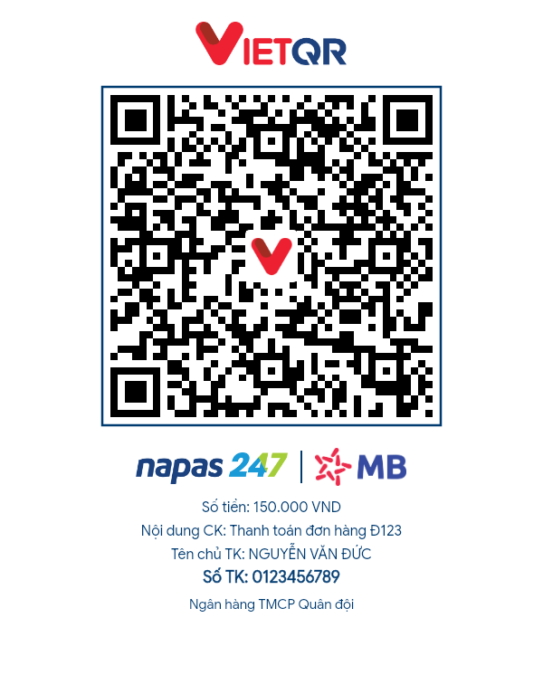
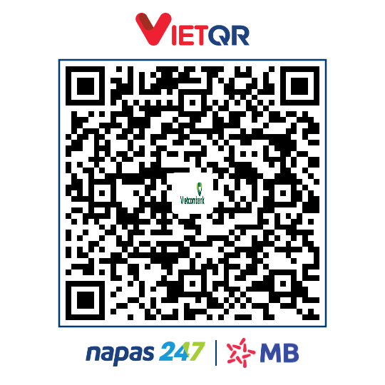

# vietqr-node

> **Tiếng Việt:** `vietqr-node` là bản port TypeScript của thư viện .NET [vietqr-core](https://github.com/Ngochiendev/vietqr-core) (MIT). Thư viện tạo và phân tích chuỗi VietQR/NAPAS247 (EMVCo), giải mã ảnh QR, vẽ thẻ thanh toán (PNG/JPEG/WebP/SVG) với logo ngân hàng, và gọi cổng deeplink mở app ngân hàng. Mọi thứ chạy trong tiến trình Node, không gọi mạng (trừ client deeplink), không cần api.vietqr.io. Đây **không** phải sản phẩm chính thức của NAPAS/VietQR.

TypeScript port of [Ngochiendev/vietqr-core](https://github.com/Ngochiendev/vietqr-core) at commit `1b92450`: build and parse VietQR / NAPAS247 EMVCo payloads, decode QR images, render payment cards, and call a deeplink gateway. Payload, parse, decode, render and the bank catalog are fully offline: no network calls, no CDN, no runtime downloads (the ZXing WASM ships in the package).

- Node ≥ 20, ESM and CommonJS, TypeScript declarations included.
- Payload output equals upstream byte for byte (pinned by fixtures generated from upstream).
- Upstream parity, member by member: [docs/parity.md](docs/parity.md).

## Install

```sh
npm install vietqr-node
```

Runtime dependencies: `@napi-rs/canvas` (prebuilt Skia binaries), `qrcode`, `zxing-wasm`. NestJS is an optional peer.

## Build a payload

```ts
import { createPayload, createDynamicAccount, createStaticCard } from 'vietqr-node';

createDynamicAccount('970422', '0123456789', 150000, 'Thanh toán đơn hàng Đ123');
createStaticCard('970422', '9704229999999999');

createPayload({
  bankBin: '970422', accountNo: '0123456789', serviceType: 'account', // or 'card'
  amount: 150000, description: 'Thanh toan', billNumber: 'HD001', referenceLabel: 'REF1',
  merchantName: 'Cửa hàng', merchantCity: 'HANOI', // qrType: 'static' | 'dynamic' (inferred from amount)
});
```

Like upstream, each tag 62 sub-field (bill number, reference label, description) is diacritics-stripped and silently truncated to 25 characters, and tag 62 is capped at 99. Invalid input throws `VietQrError` (`qr.invalid_bin`, `qr.invalid_amount`, `qr.missing_param`).

Utilities: `calcCrc`, `genCrcCode`, `verifyCrc`, `removeDiacritics`, `extractBinFromEmvCo`.

## Parse

```ts
import { parse, tryParse } from 'vietqr-node';

const info = parse(payload);            // throws VietQrError
info.bankBin; info.accountNo; info.amount; info.description; info.serviceType; info.isValidCrc; info.rawTags;

tryParse(payload, { strictCrc: false, maxPayloadLength: 1024 }); // null instead of throwing
```

## Decode an image

```ts
import { decodeImage, readQrText } from 'vietqr-node';

const info = await decodeImage(pngOrJpegOrWebpBytes); // throws qr.image_decode_failed when no QR is found
const text = await readQrText(bytes);                 // null when the image holds no QR code
```

Decoding uses ZXing (WebAssembly) loaded from the package's own `assets/zxing_reader.wasm`, initialised once per process and shared by concurrent calls. PNG, JPEG and WebP only; GIF, AVIF and others are rejected with `qr.invalid_image`.

## Render

```ts
import { render, renderDataUrl } from 'vietqr-node';

const png = await render(payload, { bankBin: '970422', accountName: 'NGUYỄN VĂN ĐỨC' });         // compact card, PNG
const print = await render(payload, { template: 'print', format: 'jpeg', quality: 90,
  bankBin: '970422', accountNo: '0123456789', accountName: 'Nguyễn Văn Đức', amount: 150000, description: 'Thanh toán' });
const svg = await render(payload, { template: 'qr_only', format: 'svg', size: 800 });       // string
const url = await renderDataUrl(payload, { format: 'webp' });                               // data:image/webp;base64,...
```

| `compact` (540×540) | `print` (600 × 590 + lines·28 + 16) | `qr_only` (`size`²) |
|---|---|---|
|  |  |  |

Options: `template` (`compact` default, `print`, `qr_only`), `format` (`png` default, `jpeg`, `webp`, `svg`), `size` (`qr_only` only, default 500), `quality` (1–100, default 100), `serviceType` (`'card'` prints "Số thẻ"), `bankBin` / `bankName` / `bankFullName` (missing names and the bank logo are filled from the catalog), `bankLogo` (bytes; replaces upstream's `BankLogoUrl`), `accountNo`, `accountName`, `amount`, `description`, `centerLogo` (bytes, base64 or data URL), `centerLogoRatio` (`qr_only`; default 0.18, clamped 0.05–0.35).

Cards are drawn with the bundled Google Sans font, so Vietnamese text renders the same on every machine. Card SVGs convert text to paths (no font needed by the viewer) and have fixed `width`/`height` without a `viewBox`. An unknown BIN still renders: the BIN is printed in place of the bank logo.

## Bank catalog

```ts
import { banks, findBank, getBankLogo } from 'vietqr-node';

banks.length;            // 76 banks, same shape as api.vietqr.io /v2/banks
findBank('970422');      // by BIN, code ('MB') or short name ('MBBank')
getBankLogo('970422');   // PNG Buffer, or undefined
```

## Deeplinks (`vietqr-node/deeplink`)

The only part of the package that uses the network (global `fetch`).

```ts
import { VietQrDeeplinkClient } from 'vietqr-node/deeplink';

// Default: discover the gateway from upstream's vietqr-discovery.json, fall back to https://vietqr.hiendev.io.vn
const client = new VietQrDeeplinkClient();
// Or your own gateway (skips discovery):
const own = new VietQrDeeplinkClient({ baseUrl: 'https://deeplink.example.com' });

await client.getSupportedApps();                 // [] on error
await client.createIntent('mb', payload);        // { url, expiresInSeconds } | null (null on bad CRC, non-2xx, error)
```

Options and defaults: `baseUrl`, `discoveryUrl` (upstream's), `defaultGateway` (`https://vietqr.hiendev.io.vn`), `enableDiscovery` (true), `discoveryCacheHours` (12), `timeoutSeconds` (10), `fetch`. Every method takes an optional `AbortSignal`; aborting rejects with the signal's reason.

## NestJS (`vietqr-node/nestjs`)

```ts
import { VietQrModule, VietQrService, VietQrDeeplinkClient } from 'vietqr-node/nestjs';

@Module({ imports: [VietQrModule.forRoot({ deeplink: { baseUrl: 'https://deeplink.example.com' }, isGlobal: true })] })
export class AppModule {}
```

`VietQrService` exposes `createPayload`, `parse`, `decodeImage`, `render`, `renderDataUrl`, `findBank` and `banks`. Requires `@nestjs/common`, `@nestjs/core` and `reflect-metadata` (optional peers).

## Express example

[`examples/express/server.ts`](examples/express/server.ts) ports upstream's Web API controllers: `GET /api/v1/vietqr-core/generate`, `GET /image`, `POST /decode` (raw `image/*` body or JSON `imageBase64`), `POST /parse`, `GET /banks`, `GET /banks/:binOrCode`, `GET /deeplink/apps`, `POST /deeplink/intents`. Run it with `npm run build` at the repo root, then `npm install && npm start` in `examples/express` (Node ≥ 22.6 for `--experimental-strip-types`).

## Image limits

Image inputs may come from untrusted uploads, so these fixed limits apply to `decodeImage`, `readQrText`, `centerLogo` and `bankLogo`. Dimensions are read from the file header and checked **before** any pixel decode or raster allocation. These are deliberate restrictions relative to upstream, not configuration options.

| Limit | Value | Error |
|---|---|---|
| Encoded image size | ≤ 10 MiB (10,485,760 bytes) | `qr.image_too_large` |
| Base64 logo string | ≤ 13,981,016 characters, checked before decoding; decoded bytes then ≤ 10 MiB | `qr.image_too_large` |
| Pixels | ≤ 16,000,000, and ≤ 8192 on either axis | `qr.image_too_large` |
| Format | PNG, JPEG, WebP (VP8, VP8L, VP8X) with a readable header and non-zero dimensions | `qr.invalid_image` |
| `render` `size` | integer 1–4096, never clamped | `qr.invalid_render_size` |
| Any output surface | ≤ 16,000,000 pixels (so `qr_only` tops out below 4096²) | `qr.image_too_large` |

The limits bound each call, not total server load; limit request concurrency in your app.

## Error codes

All failures throw `VietQrError` with a stable `code` and upstream's Vietnamese message:

| Code | Meaning |
|---|---|
| `qr.missing_param` | required input missing or blank |
| `qr.invalid_amount` | amount not a positive integer of at most 13 digits |
| `qr.invalid_bin` | BIN is not exactly 6 digits |
| `qr.bank_not_found` | bank not in the NAPAS catalog |
| `qr.invalid_template` | template is not `compact`, `print` or `qr_only` |
| `qr.system_error` | internal error |
| `qr.invalid_payload` | not EMVCo TLV, longer than `maxPayloadLength`, or too long to fit in a QR code (render) |
| `qr.invalid_crc` | tag 63 CRC mismatch (with `strictCrc`) |
| `qr.not_vietqr` | no tag 38 / NAPAS AID `A000000727` |
| `qr.image_decode_failed` | image could not be decoded or holds no QR code |
| `qr.image_too_large` | image or output over the limits above |
| `qr.invalid_image` | malformed or unsupported image |
| `qr.invalid_render_size` | `size` outside 1–4096 or not an integer |

## Known upstream differences and quirks

These are kept on purpose so that output stays identical to upstream:

- **Builder succeeds, parser rejects (UTF-16 vs UTF-8 lengths).** Upstream's builder writes TLV lengths in UTF-16 code units, while its parser reads them as UTF-8 bytes. Any field with characters outside one-byte UTF-8 therefore builds fine but fails to parse with `qr.invalid_payload`. The fixture-proven cases are:
  1. description `Pay 😀 now`
  2. description `中`
  3. description of 24 × `x` followed by `😀`: truncation to 25 UTF-16 units leaves a lone high surrogate `U+D83D` in the payload (upstream CRC `A632`)
  4. merchant name `Straße ı ffi` (upper-cased by upstream to `STRAßE ı ffi`: tag 59 declares 10 UTF-16 units, 14 UTF-8 bytes)

  vietqr-node reproduces both sides exactly. Vietnamese text is unaffected, because diacritics are stripped before building. Avoid emoji and non-Latin characters in payload fields if the payload must be parsed again.
- **Parsing is strict about whitespace.** A payload with surrounding whitespace fails the CRC check (`qr.invalid_crc`), as upstream. Lowercase hex in the CRC is accepted, as upstream.
- **`rawTags` key order.** `VietQrInfo.rawTags` is a plain object. JavaScript enumerates integer-like keys (`"00"` is not one, but `"38"`, `"54"`, `"62"` … are) in ascending numeric order before other keys, so iteration order can differ from upstream's insertion-ordered dictionary. Values are identical; do not rely on key order.
- **QR matrix.** QR codes are generated with `qrcode` at error-correction level Q (as upstream's QRCoder). Module placement can differ from upstream's images; the encoded payload is the same.
- **Offline bank logos.** `bankLogo` takes bytes instead of upstream's `BankLogoUrl`.

## Credits and license

This package is a port of [vietqr-core](https://github.com/Ngochiendev/vietqr-core) by Ngochiendev, used under the MIT License. Bundled assets (bank catalog, bank logos, Google Sans font, VietQR/NAPAS247 logos) come from upstream. `zxing_reader.wasm` is from [zxing-wasm](https://github.com/Sec-ant/zxing-wasm) (MIT), built from [zxing-cpp](https://github.com/zxing-cpp/zxing-cpp) (Apache-2.0); see [assets/THIRD_PARTY_NOTICES.md](assets/THIRD_PARTY_NOTICES.md).

MIT. See [LICENSE](LICENSE), which keeps upstream's `Copyright (c) 2026 Ngochiendev` notice alongside ours.

**Trademarks:** VietQR, NAPAS and NAPAS247 names and logos belong to NAPAS; bank logos belong to their banks. This is an independent project, not an official VietQR/NAPAS product and not made by upstream's author. Software is provided AS IS. See [DISCLAIMER.md](DISCLAIMER.md).
